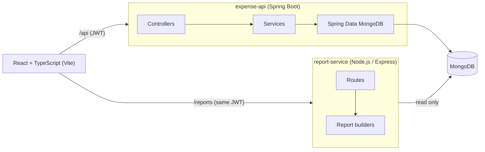

# Expense Tracker


A personal finance app for logging daily expenses, setting monthly budgets per category and seeing where the money went. It is split into two backend services: a **Spring Boot + MongoDB** REST API that owns the data, and a small **Node.js / Express** service that builds reports (CSV export and a 6-month spending trend). The UI is **React with TypeScript**.

The main goal: find out *before* the end of the month that a category is close to its budget, not after.

## Features

- Sign up / sign in with JWT; passwords hashed with BCrypt
- Add, edit and delete expenses with category, payment method, tags and notes
- Filter expenses by date range, category and text, with paging
- Monthly budgets per category with status: on track, warning (80%+), over budget
- Dashboard for any month: total spent, budget left, progress bar per category
- 6-month trend chart and CSV export, served by the separate report-service
- Every query is scoped to the signed-in user, so one user can never read or change another user's data
- Demo account with three months of sample data when run with Docker

## Architecture



- **expense-api** issues the JWT on login (subject = user id) and handles all writes.
- **report-service** verifies the same token with the shared secret and only reads the `expenses` collection. Reports are read-heavy and change more often than the core API, so keeping them in their own service means I can change or scale them without touching the API.
- In Docker, nginx serves the React build and routes `/api` and `/reports` to the right service, so the browser only talks to one origin.

## Some decisions worth mentioning

**Money is never a double in the API.** Amounts are `BigDecimal` in Java and stored as MongoDB `Decimal128` (`@Field(targetType = DECIMAL128)`). By default Spring Data stores `BigDecimal` as a string, which breaks `$sum` in aggregations. The Node service converts to cents before adding things up, so totals like 0.10 + 0.20 come out as 0.30.

**Monthly summary is one aggregation.** `SummaryService` runs a `$match` on user + date range and a `$group` by category, then `SummaryCalculator` (plain Java, unit tested) merges the totals with the budgets and works out percent used and status.

**Dates are stored as UTC midnight.** The default Spring converter turns `LocalDate` into a `Date` using the JVM time zone. If the API and the report-service run in different time zones, an expense on the 1st of the month can land in the previous month in the trend. `MongoConfig` switches to the driver's java.time codecs, which always use UTC.

**CSV export is safe to open in Excel.** Values starting with `=`, `+`, `-` or `@` are prefixed so a description like `=HYPERLINK(...)` is shown as text instead of being run as a formula.

## Tech stack

| Part | Technologies |
|---|---|
| expense-api | Java 17, Spring Boot 3.3, Spring MVC, Spring Security, Spring Data MongoDB, Bean Validation, jjwt, springdoc-openapi |
| report-service | Node.js 22, Express 4, MongoDB Node driver, jsonwebtoken |
| Frontend | React 18, TypeScript, React Router, Axios, Vite |
| Database | MongoDB 7 |
| Testing | JUnit 5, AssertJ, MockMvc, Testcontainers (MongoDB), node:test, Vitest |
| DevOps | Docker, docker-compose, nginx, GitHub Actions |

## Run it

### With Docker (everything)

```bash
docker compose up --build
```

- App: http://localhost:3000 (demo login: `demo@expensetracker.dev` / `demo1234`)
- API docs: http://localhost:8080/swagger-ui.html
- report-service health: http://localhost:4000/health

### Local development

Start MongoDB:

```bash
docker run -d --name expense-mongo -p 27017:27017 mongo:7.0
```

Then in three terminals:

```bash
# 1. API on :8080  (add --spring.profiles.active=demo to load sample data)
cd expense-api && mvn spring-boot:run

# 2. report-service on :4000
cd report-service && npm install && npm run dev

# 3. UI on :5173 (proxies /api and /reports to the services above)
cd frontend && npm install && npm run dev
```

Both services read `MONGODB_URI` and `JWT_SECRET` from the environment. The defaults are for local use only.

## API

All endpoints except `/api/auth/**` need `Authorization: Bearer <token>`.

| Method | Path | Description |
|---|---|---|
| POST | `/api/auth/register` | Create an account, returns a token |
| POST | `/api/auth/login` | Sign in, returns a token |
| GET | `/api/expenses?from=&to=&category=&q=&page=&size=` | List expenses (newest first) |
| GET | `/api/expenses/{id}` | One expense |
| POST | `/api/expenses` | Add an expense |
| PUT | `/api/expenses/{id}` | Update an expense |
| DELETE | `/api/expenses/{id}` | Delete an expense |
| GET | `/api/budgets` | List budgets |
| PUT | `/api/budgets/{category}` | Set or change a category budget |
| DELETE | `/api/budgets/{category}` | Remove a budget |
| GET | `/api/summary?month=2026-10` | Spending vs budget for a month |
| GET | `/reports/trend?months=6` | Monthly totals by category (report-service) |
| GET | `/reports/monthly.csv?month=2026-10` | CSV export (report-service) |

Example:

```bash
curl -X POST localhost:8080/api/expenses \
  -H "Authorization: Bearer $TOKEN" -H "Content-Type: application/json" \
  -d '{"amount": 42.75, "category": "FOOD", "date": "2026-10-03", "description": "Lunch", "paymentMethod": "CARD", "tags": ["work"]}'
```

Errors use RFC 7807 problem details, with field errors under `errors`:

```json
{ "status": 400, "detail": "Validation failed", "errors": { "amount": "must be at least 0.01" } }
```

## Tests

```bash
cd expense-api && mvn verify        # needs Docker for the Testcontainers MongoDB
cd report-service && npm test
cd frontend && npm test
```

- `ExpenseApiIntegrationTest` runs the real API against MongoDB in a container: CRUD, filters and paging, the monthly summary against budgets, validation errors, and a check that one user gets 404 on another user's expense.
- `SummaryCalculatorTest` covers budget percentages and statuses, including spending exactly the limit.
- report-service tests cover the trend and CSV builders and the HTTP routes (auth, query validation, CORS) using an in-memory repository.

GitHub Actions runs all three on every push.

## Project layout

```
expense-api/src/main/java/com/saicharan/expensetracker
├── budget     Budget document, repository, service, controller
├── common     Exceptions, global error handler, page response
├── config     Security, Mongo config, demo data seeder
├── expense    Expense document, filters and CRUD
├── security   JWT service and filter
├── summary    Monthly aggregation and budget calculator
└── user       User document, register / login
report-service/src
├── app.js               Express routes
├── auth.js              JWT check shared with expense-api
├── reports.js           Trend and CSV builders (pure functions)
└── expenseRepository.js Read-only Mongo queries
frontend/src
├── api        Axios client and types
├── components Budget bar, trend chart, expense form
└── pages      Dashboard, Expenses, Budgets, Login, Register
```

## Next things I'd like to add

- Recurring expenses (rent, subscriptions) that get added automatically each month
- Receipt photo upload to S3
- Email alert when a category crosses its warning limit

## License

MIT
